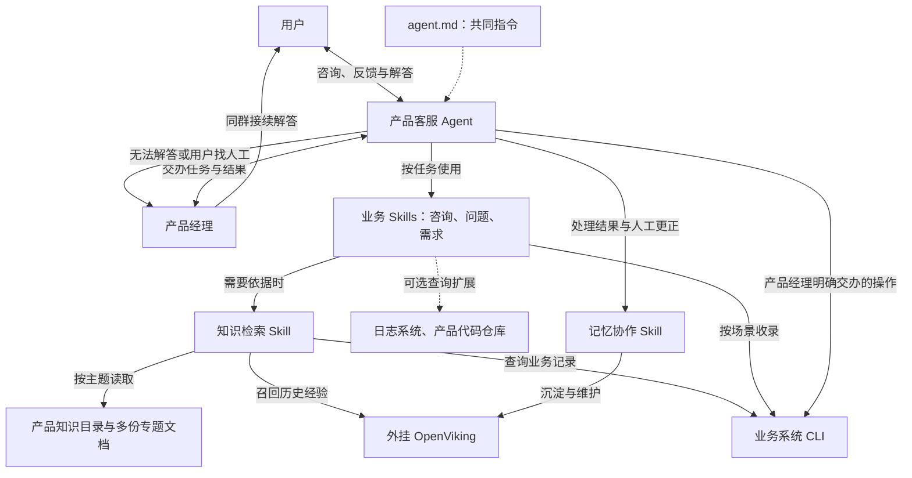

# 火星产品智能客服

一个服务用户、协助产品经理的 Agent，围绕使用咨询、问题反馈和需求分析开展工作。[SPEC.md](SPEC.md) 记录产品行为和验收标准，本文件维护当前架构与文件职责。

## 当前架构

总指令负责共同判断，三个业务 Skills 处理具体场景，知识检索与记忆协作是两个共用 Skills。图中的 Skills 都由同一个 Agent 使用，按当前任务选择，不是独立的客服 Agent，也不要求每次依次执行全部 Skills。

会话中的参与者分为用户和产品经理两类身份。产品经理既可以接续解答，也可以向助手交办查询、分析和系统操作任务。

## 主要文件

- [SPEC.md](SPEC.md)：访谈确认的产品形态、三类场景、执行边界与验收标准。
- [TEST_CASES.md](TEST_CASES.md)：30 条标准测试案例、固定资料与初始记录、评分和运行记录规范，供开发评审使用。
- [agent.md](agent.md)：客服的总指令，始终适用的共同规则。
- [skills/](skills/)：三个业务 Skills 和两个共用 Skills，每个只维护一份 `SKILL.md`。

`CLAUDE.md` 与 `.claude/skills` 仅保留现有本机入口的兼容引用，实际内容统一维护在上述文件中。

## 职责划分

| 位置 | 负责的判断与规则 | 交付 |
| --- | --- | --- |
| [agent.md](agent.md) | 理解与切换任务、服务边界、通用写入核查、结果反馈、人工接续、表达与信息边界 | 当前任务的整体推进与对话结果 |
| [faq-support](skills/faq-support/SKILL.md) | 如何回答功能、规则、权限与操作问题，何时转入问题或需求处理 | 适用的结论与必要步骤 |
| [issue-support](skills/issue-support/SKILL.md) | 排查依据、停止条件、深入查询、何时建单、问题如何查重与整理 | 问题判断、有效动作或后续工单内容 |
| [requirement-support](skills/requirement-support/SKILL.md) | 价值、影响、成本与优先级分析，何时收录、需求如何查重与补充 | 需求分析、建议及记录内容 |
| [knowledge-search](skills/knowledge-search/SKILL.md) | 选择文档、历史记忆或业务数据来源，读取正文，处理时效与依据冲突 | 有来源和适用范围的资料，以及待确认部分 |
| [memory-management](skills/memory-management/SKILL.md) | 按 OpenViking 策略沉淀、修正或遗忘，核对记忆更新结果 | 可复用记忆及真实的维护结果 |

意图理解是 Agent 推进任务时的共同职责，合入总指令。知识检索统一读取依据，包括 OpenViking 中的历史经验；记忆协作只在沉淀与维护时使用，两者不互相调用。维护记忆时读取目标属于核对更新范围，不代替业务检索。

业务 Skills 决定何时记录、记录什么、如何判断同类事项。目标核对、超时后的结果查询、成功确认和失败反馈统一遵循总指令，避免各场景分别维护不同的执行规则。产品经理直接交办的记录操作也受这些共同规则约束，不强制经过完整业务分析；仅查询和分析时交付结果，不新增或修改业务记录。

具体 CLI 命令、参数、权限及字段由实际接入能力提供。工具负责执行并返回结果，Skills 使用这些结果完成业务判断；当前不新增 CLI 适配层或本地业务存储。

## 信息的归属

- **产品文档**：入口维护在 `skills/knowledge-search/SKILL.md`，客服检索与记忆沉淀不自动改写它。
- **历史经验**：OpenViking 按自身策略提取与更新，由知识检索按需读取。文档、历史记录和人工解答都需核对时效与适用范围，新的有效人工更正也可成为回答依据。
- **业务记录**：以接入时指定的文档、表格或系统为准，承担需求、工单与正式产品决定的保存，最新处理状态从原系统查询。

群里给出结论、必要依据和实际处理结果，记录保存分析摘要。记忆沉淀与业务登记分别核对执行结果，不能互相替代。OpenViking 的会话提交与记忆提取遵循实际版本和策略，参见官方[会话机制](https://github.com/volcengine/OpenViking/blob/main/docs/en/concepts/08-session.md)。

## 验证方式

指令变更后核对 Skill 描述、职责归属、引用与本机入口，按 [标准测试集](TEST_CASES.md) 执行固定案例，对照 [Spec 验收场景](SPEC.md#9-验收场景) 检查可观察行为。测试集包含 30 条案例，其中 10 条用于日常快测；写入测试使用独立测试工作簿，未接入能力列为阻塞，不计作通过。测试文档和评分记录不提供给被测客服读取。

格式检查与案例推演用于验证指令组织和行为，实际接入后仍需验证工具读写及记忆效果，不能据此认定系统已完成运行验收。

## 当前边界

当前使用知识目录和多份飞书专题文档承载产品说明，普通飞书电子表格承载问题反馈和需求建议，两类记录分别放在同一工作簿的两个工作表中。实际链接与接入状态统一维护在 [knowledge-search](skills/knowledge-search/SKILL.md)，业务 Skills 引用同一配置。

本机已安装 `lark-cli 1.0.98`，文档与普通电子表格的用户授权均可用。官方飞书工具 Skills 已安装在个人 Skills 目录，供 Codex 和 Claude Code 使用；当前文档使用 `lark-doc`，反馈表使用 `lark-sheets`，项目中的五个 Skills 负责客服行为。迁移时需在目标环境安装 CLI 与工具 Skills，并完成该环境的授权，凭据不保存在本仓库。

2026-10-14 已创建并回读核对六份专题文档，覆盖消息与群聊、图片与文件、云文档与权限、普通电子表格、日历与会议、账号与通知，共 30 条问答，保留官方来源、更新时间和适用范围。原产品使用说明改为目录，保留已确认的产品背景和咨询方式。

旧多维表格中两张表均无业务记录，已停止作为收录目标。普通反馈工作簿已创建，包含“问题反馈”14 列和“需求建议”16 列，已验证表头写入、全文读取、表头样式与冻结设置；实际链接与子表标识已登记到知识检索配置和产品目录。初始化时未写入业务反馈，真实记录的新增、更新、编号定位与查重仍需在实操中验证。

OpenViking 和飞书群聊消息接入尚未联调，当前可在本任务中通过 CLI 操作文档和表格。没有相应执行能力时，助手交付可用摘要并如实说明未完成的操作。

日志和代码检索属于可选扩展。长期跟进与主动回群通知留作后续能力，需要状态事件或定时触发，以及事项编号与来源会话关联；当前不建立后台轮询或自动通知任务。

通过 Git 拉取本仓库即可获得这些文件，不额外打包，也不新增记忆服务、运行框架或本地业务记录库。
